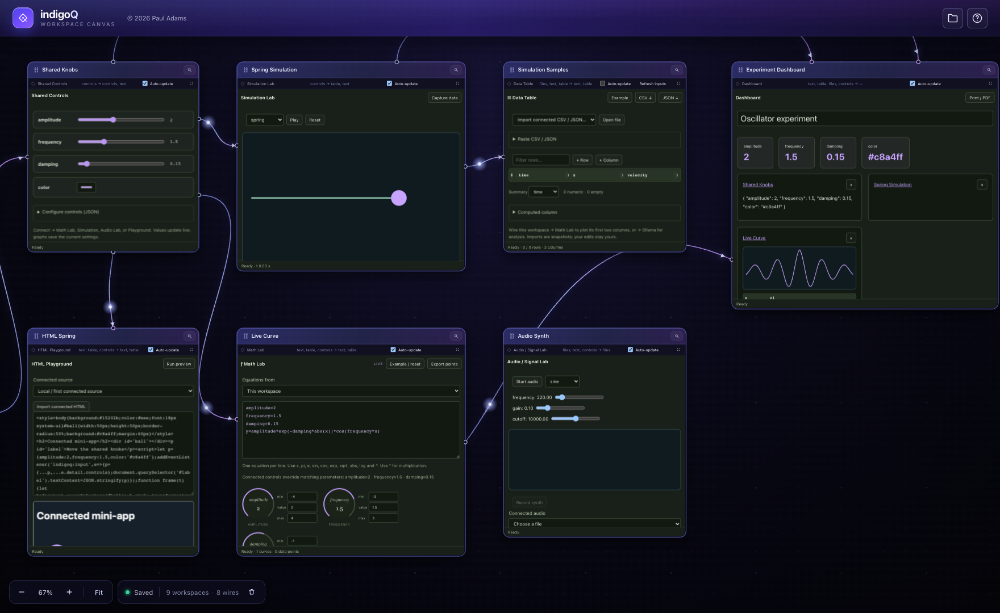
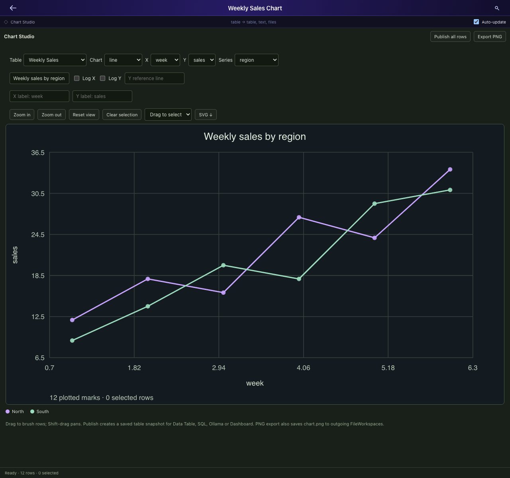
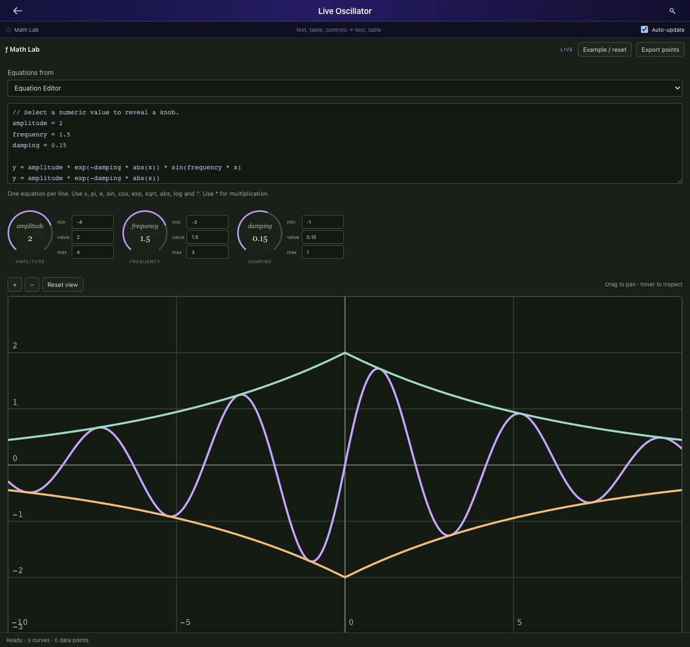

# indigoQ

[Website & workflow guides](https://majiccode.github.io/indigoQ/) ·
[Download](https://github.com/majiccode/indigoQ/releases/latest) ·
[Support development](https://paypal.me/pdgadams)

An infinite, pannable and zoomable canvas for composing data pipelines. Draw
workspaces anywhere, connect them with animated dataflow wires, and the graph is
persisted locally and to a small FastAPI service.

- **Frontend** — Next.js 16, React 19, TypeScript, canvas 2D rendering (`frontend/`)
- **Backend** — FastAPI + Pydantic, atomic JSON store (`backend/`)
- **Tooling** — [moon](https://moonrepo.dev) task runner, [uv](https://docs.astral.sh/uv/) for Python, pnpm for Node

## See it in action

**New here?** Open **Graph files → Examples** and try **PDF Read-aloud**,
**Chart Studio**, or **Notes to Structured Data**. Each includes sample input and
a Start here guide. See [three first workflows](docs/FIRST_WORKFLOWS.md) for
steps and a first-user feedback checklist.

The header's **Start here** button opens these starters directly and lets you
save the current graph before replacing it. Workspace input badges distinguish
live inputs, captured snapshots, and newly available input; Run and Import
remain explicit where appropriate.

**[Watch the indigoQ introduction on YouTube](https://www.youtube.com/watch?v=347NDTBdziw)** —
a short narrated overview with app screenshots and an illustrated PDF read-aloud
workflow. You can also [watch it on the website](https://majiccode.github.io/indigoQ/#watch).

Connect live workspaces on the canvas, then open any workspace fullscreen to
explore the details. These screenshots show examples included with indigoQ.

### Interactive Studio — connect an experiment

Shared controls drive a spring simulation, a mathematical curve, and an HTML
mini-app, with a dashboard bringing the experiment together.

[](docs/screenshots/interactive-studio.png)

[Explore the example graph](frontend/public/examples/interactive-studio.json)

### Chart Studio — turn tables into interactive charts

Compare weekly sales across regions, switch chart types, brush points to select
rows, and export charts as PNG or SVG.

[](docs/screenshots/chart-studio.png)

[Explore the example graph](frontend/public/examples/chart-studio.json)

### Oscillator Lab — equations become live plots

Connect an equation editor to Math Lab and adjust amplitude, frequency, and
damping with live knobs. Export sampled curves for further analysis.

[](docs/screenshots/oscillator-lab.png)

[Explore the example graph](frontend/public/examples/oscillator-lab.json)

### Creative Workshop — circuits, models, art, and ambient controls

Build a circuit, inspect a 3D mesh, place it in a scene, turn table data into
character art, and derive ambient controls from text. The example includes all
six new workspaces, a preloaded model/scene, a mood dashboard, and connected file
exports. USB access begins only after connecting a device explicitly.

[Explore the example graph](frontend/public/examples/creative-workshop.json) ·
[Read the workspace reference](docs/WORKSPACES.md)

### Listen to your PDFs

Connect **FileWorkspace → Document Preview → Text to Speech**, select a PDF,
and click **Speak it all** to listen to its extracted text. Choose a browser voice
and adjust rate and pitch; no Ollama model is required.

[Follow the PDF read-aloud guide](https://majiccode.github.io/indigoQ/listen-to-pdf-documents/)

Want to share indigoQ? The [launch kit](docs/LAUNCH.md) includes announcement copy
and a short demo recording script.

**Try them:** [download a portable build](https://github.com/majiccode/indigoQ/releases),
open the file-menu icon in the app header, and choose **Examples**. Each example
loads a complete canvas you can explore and edit.

## Prerequisites

For the **pre-built portable bundle**, see
[installation instructions](docs/INSTALL.md) and
[GitHub Releases](https://github.com/majiccode/indigoQ/releases). The bundle
includes Python, the backend, and the frontend; no runtime dependencies are
needed. The prerequisites below are only for source development.

- moon `>= 2`
- uv `>= 0.11` (Python 3.11+; pinned to 3.13 via `backend/.python-version`)
- Node.js 20+ and pnpm (backend and frontend toolchains are invoked via moon)

## Run

```bash
moon run :setup   # install dependencies for both projects
moon run :dev     # start frontend + backend together
```

- Frontend: <http://localhost:3000>
- API: <http://127.0.0.1:8787>

Run a single side:

```bash
moon run backend:dev    # uv run uvicorn app.main:app --reload --host 127.0.0.1 --port 8787
moon run frontend:dev   # pnpm dev
```

Port `8787` is used for the API because `8000` may already be taken on this
machine. Change it in `backend/moon.yml` and `frontend/next.config.ts`
(`INDIGOQ_API_URL`) if needed.

## Checks

```bash
moon run :build              # next build + python byte-compile
moon run frontend:lint       # eslint
moon run frontend:typecheck  # tsc --noEmit
moon run backend:test        # pytest
moon run backend:lint        # ruff check
moon run backend:format      # ruff format
```

Run the frontend expression/data-flow tests with `pnpm --dir frontend test`.

## Build and release

```bash
# Build the portable bundle for the current machine:
node scripts/build-release.mjs --build-only

# From clean, up-to-date main: bump patch, check, commit, tag, push, and publish:
./release.sh

# Optional: larger bump, explicit version, preview, or don't wait for Actions:
./release.sh minor
./release.sh 1.0.0
./release.sh --dry-run
./release.sh --no-wait
```

The tag workflow builds macOS arm64/x64, Windows x64, and Linux x64 bundles.
The self-contained bundles, one-line installers, checksums, and installation
instructions are published together after checks pass.
`./release.sh` reads the current version, increments the patch version (for example,
`0.1.4` → `0.1.5`), and waits for Actions to finish before printing the release URL.
Commit your application changes first; the script commits the version bump for you.
See [the release guide](docs/INSTALL.md#build-and-publish-from-source) for prerequisites.

## Controls

| Action                    | Gesture                                       |
| ------------------------- | --------------------------------------------- |
| Create workspace          | Drag on empty canvas                          |
| Move workspace            | Drag its header                               |
| Connect workspaces        | Drag from a workspace border onto another      |
| Rename                    | Double-click header, or select + `Enter`       |
| Delete selected           | `Delete` / `Backspace`                         |
| Pan                       | `Space` + drag, middle-drag, or plain scroll   |
| Zoom                      | `⌘`/`Ctrl` + scroll, `+` / `-`, `0` to fit     |
| Cancel current gesture    | `Escape`                                       |

## Workspace types and connections

Workspaces with inputs expose a persisted **Auto-update** toggle in their toolbar.
When disabled, connected data stays at a snapshot until **Refresh inputs** is
pressed. Live previews keep their existing auto-update defaults; Transform, SQL,
and Data Table default to manual processing. Enable the toggle on these processors
to rerun when input data changes. Data Table follows the first connected table,
then text source, then file source. Turn it off to keep independent table edits.
Ollama generation, model comparisons, microphone recording, playback, and HTTP
requests retain their explicit Run/Start/Send controls.

Blank workspaces offer a **Choose workspace type** toolbar. Types register their
React component and input/output capabilities in `workspaceTypes.ts`. A type is
immutable once assigned. Dropping files onto a blank workspace selects FileWorkspace.

- **FileWorkspace** collects files and exposes a `files` input/output.
- **TextEditor** is a syntax-colored editor with undo/redo, inline numeric knobs,
  and selection-driven curve/wave visualizations. Select a number to adjust it.
  **Example** inserts a sample document; visualizations do not execute code.
  Select colours (hex, RGB, HSL, HSV/HSB) for a colour wheel and alpha controls,
  booleans for a toggle, unit-bearing numbers for a unit-preserving knob, and
  angles for a circular dial. Two-number arrays or `{ x, y }` literals open an XY
  pad; longer numeric arrays open a draggable curve with individual value controls.
  All visual edits participate in the editor's undo/redo history.
- Wire **FileWorkspace → TextEditor** to expose files under **File → Open**.
- Wire **TextEditor → FileWorkspace** to expose a **File → Save** destination.
  Both directions can coexist; overwrite requires explicitly choosing a file.
- Wire **Image Studio → FileWorkspace** to save published PNGs into that workspace's
  files. Publishing again overwrites `edited.png` in each connected FileWorkspace.
- Editor drafts are saved independently of files. Open/Save require the API and
  validate directed connections server-side. TextEditor opens UTF-8 text files.
- The workspace toolbar's fullscreen button opens `/workspace?id=…`; double-click
  the workspace toolbar to expand while leaving editor double-click text selection intact.
- File drops remain available on graph previews below the interaction zoom threshold.

### Math Lab, Data Table, and local AI

Choose these types from any blank workspace. Use fullscreen for a larger editing
surface. Their settings and completed outputs are saved with the graph.

- **Math Lab** plots one expression per line, with named parameters such as
  `amplitude = 2` and curves such as `y = amplitude * sin(x)`. Parameters get
  live knobs with editable values and ranges. Multiple curves, visibility toggles,
  drag-to-pan, zoom buttons, coordinate inspection, and sampled CSV export are
  included. The expression language supports `+ - * / ^`, parentheses, `pi`, `e`,
  and common math functions; it does not execute JavaScript. Use explicit `*`
  for multiplication. **Equations from** selects an incoming TextEditor or Ollama
  output and updates the plot when that source is saved.
- **Data Table** imports CSV or JSON from a local file, pasted text, or a connected
  workspace. JSON can be an array of objects or an array of rows (first row is the
  header). Edit cells and headers, add/delete rows, add columns, sort/filter,
  inspect numeric summaries, or add a computed column using a math expression.
  CSV and JSON exports include the whole table. Imports are snapshots by default;
  sorting and filtering are view-only. Tables support up to 100 columns and
  10,000 rows, displaying the first 500 matching rows.
- **Ollama** lists installed local models and streams responses through the backend.
  Choose a model, enter instructions and a prompt, select incoming context sources,
  and press **Run**. Temperature, JSON output, presets, cancellation, output
  download/copy, and the last context snapshot are available. Connected files must
  be UTF-8 text. Generation is manual; changes to inputs never launch model calls.

Ollama defaults to `http://127.0.0.1:11434`. Start it before refreshing models.
To use another server, set `OLLAMA_BASE_URL` in the backend environment.

Try these connections:

1. **Ollama → Math Lab:** choose the **equations** preset, Run, then select that
   Ollama workspace under Math Lab's **Equations from**.
2. **Ollama → TextEditor → Math Lab:** import the generated text into the editor,
   then select the editor as the equation source. Adjusting editor numbers updates
   the plot after the draft is saved.
3. **FileWorkspace → Data Table → Math Lab:** import a connected CSV/JSON file;
   Math Lab overlays the first connected table as scatter points with X/Y selectors.
4. **Math Lab → Data Table:** import **sampled curves** to capture 201 samples across
   the current X range, including current parameter-knob values.
5. **Data Table → Ollama:** select the table as context and use **summarize**, or
   **Ollama → Data Table:** use **extract** and import its completed JSON response.

The TextEditor toolbar also offers **Import text…** for incoming text connections.
This explicitly replaces the current draft with a snapshot of the chosen output.

## Studio workspace collection

Additional mini-apps are available from the workspace type picker. See the
[new workspace reference](docs/WORKSPACES.md) for setup, export formats, and current behavior.

| Workspace | Working features and connections |
|---|---|
| **Shared Controls** | Named numeric sliders, toggles, selects, colors, text, and trigger buttons. Edit definitions as JSON. Connect to Math Lab, Simulation, Audio, Playground, Dashboard, or a recording Timeline. |
| **Simulation Lab** | Spring, pendulum, orbit, predator/prey, and epidemic simulations; play/pause, time scrubber, draggable initial displacement for spring/pendulum. **Capture data** publishes a table. |
| **Timeline / Sequencer** | Linear numeric parameter tracks, looping, scrubbing, and 10 Hz recording of incoming controls into a table. **Reset / release controls** returns control to connected manual knobs. |
| **HTML Playground** | HTML/CSS/JavaScript editor and sandboxed iframe. **Run preview** executes the current document. Import generated HTML from Ollama/TextEditor. Connected controls/data arrive as `indigoq:input` events. `indigoQ.publish({text, table: {columns, rows}})` offers output; **Accept output** publishes it to the graph. |
| **Audio / Signal Lab** | Sine/square/triangle/sawtooth and connected-equation waveforms, live frequency/gain/cutoff, enabled toggle, low-pass filter, oscilloscope/spectrum, synth recording, and connected audio-file playback. Start and recording require explicit clicks. |
| **HTTP / API Client** | HTTP methods, headers/body, response status/headers/timing, cancellation, and explicitly started periodic refresh. Responses publish text and, where possible, a table. Requests run through the backend; redirects are returned rather than followed. |
| **Transform** | JSON-path extraction (`$.items[0].name`), array filtering by field substring, per-record templates (`{{field}}`), regex extraction in a time-limited worker. Run explicitly to publish text/table results. |
| **SQL Explorer** | Read-only SQLite queries against connected `input1`, `input2`, … tables. Joins, grouping, and aggregates. Isolated backend memory database, 3-second query limit, 10,000 output rows. |
| **Document Preview** | Markdown, GFM tables, fenced code, inline/display mathematics, Word (.docx), PDF text extraction, and connected video playback with native controls and download fallback. Document text publishes automatically for comparison or speech; videos do not publish transcripts. |
| **Diff / Compare** | Two local or connected text sources, JSON formatting, line-level additions/removals, and publish-right-side action. |
| **Image Studio** | Local/connected images, percentage crop, resize, brightness/contrast/saturation, text annotation, RGBA pixel inspection. **Publish PNG** exposes edited images to other workspaces and saves `edited.png` into any connected FileWorkspace; connect to a vision-capable Ollama model. |
| **ASCII Art** | Render connected images as ASCII or braille art, or Data Table / Math Lab tables as sparklines. Output is text — wire to Document Preview, Text to Speech, or any text consumer. Publish saves a `.txt` file into connected FileWorkspaces. |
| **Ambient Mood** | Derive ambient controls (mood color, intensity, tempo, brightness, saturation) from connected text keywords or table statistics. Outputs `controls` — wire to Audio Lab, Simulation Lab, Dashboard, or Shared Controls to drive ambient behavior from document sentiment. |
| **USB Debug** | Interrogate USB devices: connect, claim interfaces, read/write endpoints, view traffic as hex and ASCII. Chrome/Edge only, localhost or HTTPS, user approval required. Outputs text — wire to Document Preview or Text to Speech. |
| **Electronic Workshop** | Circuit editor with component templates, built-in examples, connection checks, design JSON, and a downloadable planning package. |
| **3D Modeler** | Add sample meshes, import model JSON, change mesh colors, and export reusable model JSON. |
| **World Builder** | Place meshes from connected model exports, edit instance positions and scale, and export scene JSON. |
| **Model Bench** | Sequential model × temperature comparisons with shared connected context, streaming progress, timings, stop, 1–5 ratings, and a published results table. |
| **Knowledge Library** | Local keyword-ranked passage search across connected text and UTF-8 files, source workspace links and character offsets. Search output can be selected as Ollama context. This first version uses lexical retrieval rather than embeddings. |
| **Dashboard** | Connected control metrics, numerical charts, table previews, Markdown, images, audio, and video; title, card visibility, print/PDF. |
| **Chart Studio** | Connected tables as line, scatter, grouped bar, or histogram charts; X/Y/series mapping, hover values, log axes, reference line, zoom/pan, and brush selection. Publish all or selected rows as a table snapshot; export SVG or PNG, with PNG saved to outgoing FileWorkspaces. |
| **Speech to Text** | Full-workspace live microphone FFT, red recording toggle, language selection, interim transcription preview, and persistent transcript with text download. Wire → TextEditor to append finalized phrases or → Ollama to dictate its prompt; other studio text consumers can read the live output. Uses browser Web Speech recognition, which may require internet. |
| **Text to Speech** | Reads connected text aloud using your browser's built-in speech synthesis (no LLM or network needed). Connect Document Preview, TextEditor, Ollama, or another text source → here. Use **Speak it all** to read the full current text immediately, or **Follow** to read only text added after activation (for live/typing sources such as a TextEditor). Voice, rate, and pitch are honored from the dropdowns; click **Stop** to cancel. Voice options depend on your operating system. |
| **System Monitor** | Live CPU, memory, disk, network, GPU, and process metrics from the local backend. |

Speech to Text starts microphone access only after **Enable mic** or **Record**.
Stopping recording leaves the microphone spectrum running; **Mic off** releases
the microphone. Neither microphone access nor recognition starts on graph load.
Speech delivery is live within the current page, and does not auto-run Ollama.
Load **Examples → Voice to Ollama** for a ready-wired microphone workspace and
Ollama assistant. Dictate a question, choose an installed model, then press Run.
For a complete voice-to-data pipeline, load **Voice Expense Detective**: dictate
purchases, extract structured records with Ollama, aggregate them with SQL, and
explore spending in Chart Studio. Sample results are preloaded so the chart works
before you record or run a model; PNG exports go into Evidence Files.

### Video preview — watch connected media

Connect **FileWorkspace → Document Preview**, add a video to FileWorkspace, and
select it from **Document source**. Use the player's Play, seek, volume, and
fullscreen controls, or download the original file. FileWorkspace's file viewer
and connected Dashboard cards also support video playback.

Video is recognized by its MIME type, with common video filename extensions used
for files whose type is missing or `application/octet-stream`. Actual playback
depends on browser codecs. Videos never autoplay and are not decoded as document
text. Selecting one clears the previous text output; video transcription is not
included.

### Text to Speech — read documents and text aloud

Connect a text source such as **Document Preview** → **Text to Speech**, wait for
the document text to finish loading, then:

- **Speak it all** — reads the full current text right away. Best for static
  content like a PDF or Markdown document that won't change.
- **Follow** — arms follow mode. It marks all existing text as already spoken and
  reads only text that arrives afterward, so it's ideal for live/typing sources
  such as a connected TextEditor where you want new sentences read as you type.
- **Stop** — cancels in-flight speech.

Voice, rate, and pitch are taken from the dropdowns and applied to each
utterance. Voice options depend on your operating system's installed voices, and
browser speech synthesis requires a user gesture (the button click) to start.

Try these connections:

1. **Document Preview → Text to Speech:** open a PDF or Markdown document, wait
   for its text to extract, then press **Speak it all** to hear it read aloud.
2. **TextEditor → Text to Speech:** turn on **Follow**, then type in the editor;
   each new sentence is read as it appears.
3. **Ollama → Text to Speech:** run an Ollama generation, then press **Speak it
   all** to hear the model's response read aloud.

### ASCII Art — render images and tables as text

Wire **FileWorkspace → ASCII Art** (or **Data Table / Math Lab → ASCII Art**), then:

- **Image mode** — select a connected image (the first is used by default), choose ASCII or Braille style, and adjust contrast, brightness, column count, and inversion. The source image appears on a canvas and the character output appears alongside it. **Publish TXT** publishes text and saves a text-file snapshot in the workspace and connected outgoing FileWorkspaces; **Download TXT** saves locally.
- **Table mode** — renders numeric columns from a connected Data Table or Math Lab as sparklines (min → bar → max), giving a quick visual summary of table data as text.

The preview is character art, rather than an image description. Both image and
table previews support **Publish TXT** and **Download TXT**. Connect to
**Document Preview** to display published text or select the published TXT file.

### Ambient Mood — derive controls from text or table sentiment

Wire **Document Preview**, **TextEditor**, **Ollama**, or **Data Table → Ambient Mood**. The workspace analyzes connected text (keyword-based mood detection) or table statistics (variance, mean) and outputs control values:

- **moodColor** — a hue derived from emotional keywords (happy → yellow, calm → cyan, sad → blue, mysterious → purple, etc.)
- **intensity** — how strong the detected mood is
- **tempo** — a numeric tempo value derived from the analysis
- **brightness** and **saturation** — color vividness
- **active** — toggle

Connect **Ambient Mood → Dashboard** to inspect these named values, or to an
**HTML Playground** that reads them. Other control consumers respond only to
matching parameter names; connecting `tempo` does not automatically change an
Audio Lab `frequency` parameter.

The workspace shows a color swatch and has a JSON control-definition panel.
Analysis is keyword-based, with table statistics used when there is no connected
text. Moving a control switches to manual mode; enable **Auto mood** to resume
analysis. Custom control definitions are preserved.

### USB Debug — interrogate USB devices

Wire **USB Debug** → any text consumer (Document Preview, Text to Speech, etc.) to read data from USB devices.

- **Connect** — click **Connect USB Device**, choose a device from the browser chooser, and approve access. Chrome/Edge only, served over localhost or HTTPS.
- **Explore** — click **Explore Interfaces** to list interfaces and their IN/OUT endpoints.
- **Claim** — select an interface to claim it, then read from its IN endpoint or write hex bytes to its OUT endpoint.
- **Read** — **Read Once** requests 64 bytes; **Start Read** begins continuous reads and **Stop Read** stops further queued reads. **Disconnect** closes the device.
- **Send** — type hex bytes (e.g. `DE AD BE EF`) and click **Send** to write to the OUT endpoint.
- **Log** — traffic is shown as hex + ASCII with timestamps. The retained log is automatically published as text to downstream consumers.

On Windows, the device may need a WinUSB or libusbK driver so Windows releases the interface for the browser to claim.

See the [USB Debug reference](docs/WORKSPACES.md#usb-debug) for current connection
and read-loop constraints.

### Electronic Workshop, 3D Modeler, and World Builder

- **Electronic Workshop:** add parts or choose **Blink LED** / **LCD Controller**
  from the workspace's Examples selector. **Test circuit** checks basic
  connections. **Save design ↓** stores and downloads circuit JSON;
  **Manufacturing package ↓** downloads a text planning document.
- **3D Modeler:** add a Cube, Pyramid, Spaceship, or Car, or drop a model JSON
  file onto the canvas. Change mesh colors and use **Export model ↓** to store
  and download the model.
- **World Builder:** connect **3D Modeler → World Builder** and export the model.
  Use **Place …** to add instances, edit position/rotation/scale on all three
  axes, and use **Export world ↓** to save scene JSON including mesh geometry.

Load **Examples → Creative Workshop** to try all six new tools on a connected
canvas. The [workspace reference](docs/WORKSPACES.md) includes model JSON examples,
export behavior, and the scope of circuit checks and 3D controls.

The **Chart Studio** example in the Examples menu uses a small weekly-sales table
with two regions. Brush points and publish them, import the result in Selected
Rows, or export a PNG into Chart Exports.

### Live controls and saved outputs

Live controls travel immediately within the current page; they do not wait for an
API roundtrip. Saved control values are included in graph JSON. Matching control
names override local parameters. Timeline playback overrides connected control
values until released. Frame-by-frame playback is transient; Save JSON captures
the timeline position. Playback, sound, polling, model calls, and SQL/HTTP requests
never auto-start on graph load.

Manual result-producing actions (simulation capture, SQL, transform, model runs,
image publish, playground accept) publish persistent snapshots. Downstream Data
Table imports remain explicit unless Auto-update is enabled. Live control updates across separate browser tabs
are not synchronized frame-by-frame.

Three additional header examples cover the collection:

- **Interactive Studio:** shared controls → simulation, Math Lab, and HTML spring;
  timeline animation, captured samples, audio synth, and dashboard.
- **Data Workbench:** JSON → Transform → SQL aggregation → Dashboard, plus HTTP,
  a Markdown/math report, and JSON comparison.
- **Research & Media:** notes → Knowledge Library → Ollama, model benchmarking,
  image editing → vision model, and a research dashboard.

Each includes a Start here workspace. Use workspace fullscreen for comfortable editing.

## Persistence

### Save, load, and examples

The app header provides **Save JSON**, **Load JSON**, and **Examples**:

- **Save JSON** downloads the complete graph, including connections, embedded files,
  editor drafts, tool settings, table data, and completed AI outputs. Pending editor
  and knob changes are flushed before export. The file uses a versioned JSON envelope:
  `{ "format": "indigoq", "version": 1, "graph": { "workspaces": [], "wires": [] } }`.
- **Load JSON** replaces the current canvas and fits it into view. The whole graph
  is validated before replacement; invalid files leave the existing graph intact.
  Raw graph/API JSON and the backend's `{ "graph": …, "updatedAt": … }` files also
  load. Loading requires the backend API. Save your current graph before switching.
- **Examples** loads a prewired graph or downloads its JSON. Each example includes
  a **Start here** editor with instructions:
  - **Oscillator Lab:** equation editor → live parameter knobs and plots → sampled table.
  - **Measured vs. Model:** embedded CSV → editable measurements → model/scatter comparison.
  - **Local AI Studio:** Ollama → equation editor → plot, and context → JSON extraction → table.
    Sample completed outputs are included; choose an installed model to generate new ones.
   - **Creative Workshop:** circuit design, reusable 3D models and scenes,
     table-to-ASCII publishing, text-to-mood controls, a dashboard, and USB Debug.

Example files live in `frontend/public/examples/` and are served at `/examples/*.json`.
Model generation never runs automatically when loading a graph.

The graph is stored in `localStorage` immediately and debounced (~550 ms) to
`PUT /api/graph`, which writes `backend/data/graph.json` atomically. If the API
is unreachable the UI keeps working offline from local state. On first load,
with no local or remote graph, a sample pipeline (`Ingest → Enrich → Publish`) is
seeded.

Reset the stored graph:

```bash
rm -f backend/data/graph.json
curl -X DELETE http://127.0.0.1:8787/api/graph
```

## API

| Method   | Path           | Description                    |
| -------- | -------------- | ------------------------------ |
| `GET`    | `/api/health`  | Health probe                   |
| `GET`    | `/api/graph`   | Current graph snapshot         |
| `PUT`    | `/api/graph`   | Replace the graph              |
| `DELETE` | `/api/graph`   | Clear the stored graph         |
| `POST`   | `/api/graph/import` | Validate and replace the entire graph |
| `PUT`    | `/api/workspaces/{id}/tool` | Save typed tool settings/output |
| `GET`    | `/api/ollama/models` | List locally installed models |
| `POST`   | `/api/ollama/generate` | Stream a model response as NDJSON |

## Layout

```
backend/
  app/        FastAPI app, models, JSON store
  tests/      API tests
frontend/
  src/app/            page, layout, global styles
  src/components/     IndigoQApp (top bar), CanvasBoard (canvas + HUD)
  src/lib/            geometry, interaction, graph model, API/local persistence, renderer
```
